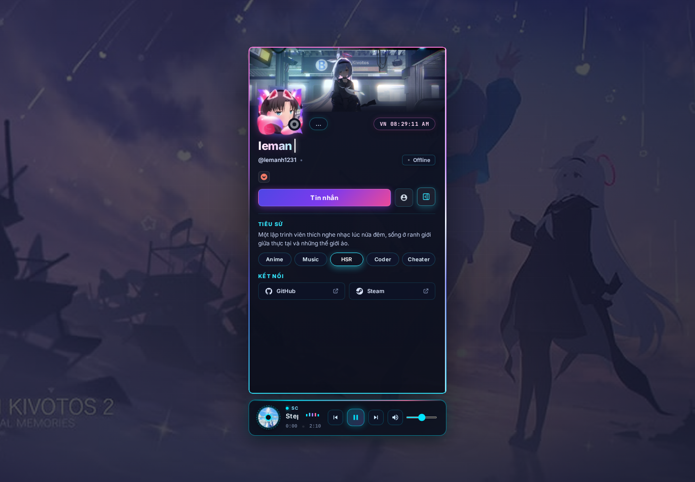

# Pro5 — Shittim Chest Profile

Website profile tĩnh với terminal Plana, hoạt động Discord/Spotify và nhạc nền.



Ảnh chụp thực tế; trạng thái online thay đổi theo thời gian.

## Cấu trúc

```text
public/
├── index.html
├── assets/
│   ├── css/styles.css
│   └── js/script.js
├── data/
│   ├── images/          # Banner, showcase, preview
│   ├── background/     # landscape/ và mobile/
│   ├── badges/         # Badge đang sử dụng
│   ├── decoration/     # Trang trí avatar
│   ├── games/
│   ├── favicon/
│   └── music/          # Audio sinh tại máy triển khai, không commit
├── styles.css -> assets/css/styles.css
└── script.js -> assets/js/script.js
tools/                  # serve.sh, deploy.sh, music-sync.py
docs/images/            # Ảnh mẫu README
```

Các symlink trong data giữ URL tương thích mà không lưu ảnh trùng.
Lavalink web, preview/test, cấu hình máy chủ và backup không thuộc repo này.

## Quick start

Requires Python 3. From a clone:

```sh
git clone https://github.com/Lemanh1231/Pro5.git
cd Pro5
bash tools/serve.sh
```

Open http://127.0.0.1:8080. No npm installation is required.

### Mẫu dựng Nginx

Sau khi deploy với `WEB_ROOT=/var/www/example`, có thể dùng server block static:

```nginx
server {
    listen 80;
    server_name profile.example.com;
    root /var/www/example;
    index index.html;
    location / {
        try_files $uri $uri/ =404;
    }
}
```

Mẫu này chưa có TLS hoặc proxy realtime. Chạy `sudo nginx -t` trước khi reload;
không ghi đè cấu hình production đang phục vụ các dịch vụ khác.

## Deployment

Requires Node.js (syntax validation), rsync and permission to write the destination.

```sh
sudo bash tools/deploy.sh
# Or choose another document root:
sudo WEB_ROOT=/var/www/example bash tools/deploy.sh
```

Default production directory: `/var/www/kotori.click`. The source workspace
does not need to be there or under `/root`. Deployment does not delete existing
files and does not deploy Lavalink or preview applications. Keep relative
compatibility symlinks: they preserve existing asset URLs.

## Optional integrations

Live Discord/Spotify/bot status requires same-origin backend proxies. This repo
contains only browser-side clients, no API servers, credentials or server config.
Frontend route names are public by design, not API keys. Static preview does not
provide those endpoints. The Lavalink dashboard is not included.

## Music and assets

Site artwork is included. Audio/originals and generated playlists are excluded
by default. Provide audio in `media/music-source/songs/` and covers in `images/`,
then run `python3 tools/music-sync.py` (requires FFmpeg/ffprobe). To publish to
production, set `MUSIC_PUBLIC=/var/www/kotori.click/data/music`.
MUSIC_SOURCE can override the originals directory. Only publish artwork/audio
you have permission to redistribute.

Ảnh trùng byte dùng chung qua symlink. Tài nguyên chắc chắn không được tham chiếu
đã loại khỏi bản mới; không xóa tùy tiện ảnh được JavaScript chọn động.

## Backup

Backup/restore production nằm ngoài Git. Sao lưu workspace và document root
trước thay đổi lớn. Deploy không tự xóa file cũ. Ảnh xóa khỏi bản mới vẫn có thể
tồn tại trong lịch sử Git; không rewrite lịch sử trong đợt dọn này.

## Security scope

No backend source, host configuration, secrets, private originals, backups or
test/preview applications are intended to be tracked. Keep credentials on the
server; never embed them in browser JavaScript. Personal profile links and public
Discord IDs are part of the displayed profile.
