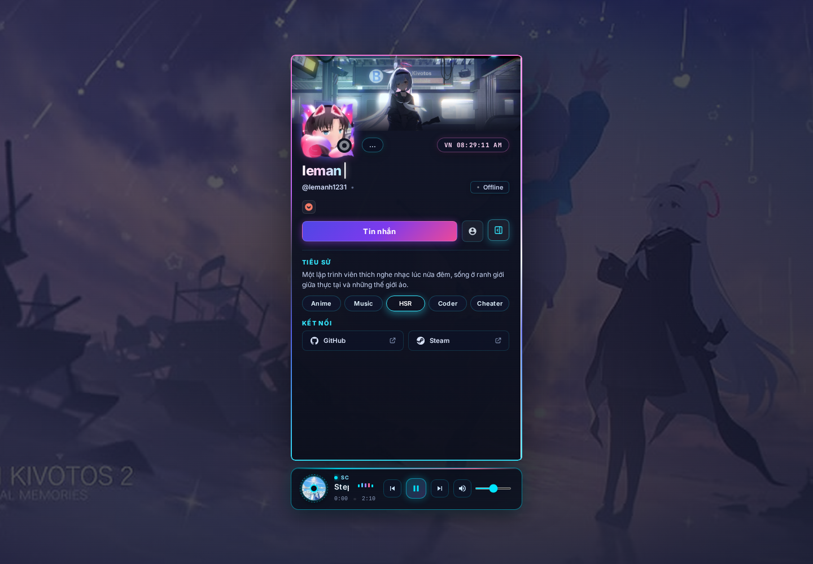

# Dựng realtime cho Pro5



## Cấu trúc

```text
services/
├── lanyard/
│   ├── lib/
│   ├── config/
│   ├── Dockerfile
│   ├── compose.yaml
│   ├── .env.example
│   ├── mix.exs
│   ├── mix.lock
│   ├── LICENSE
│   └── UPSTREAM-README.md
├── spotify/
│   ├── server.js
│   ├── package.json
│   ├── package-lock.json
│   └── .env.example
└── README.md
```

## Chuẩn bị

Cài Git, Docker Compose, Node.js 20+ và Nginx:

```bash
git clone --branch lanyard https://github.com/Lemanh1231/Pro5.git
cd Pro5
```

## Lanyard

```bash
cd services/lanyard
cp .env.example .env
chmod 600 .env
```

Tạo bot tại Discord Developer Portal. Thiết lập bot và quyền cần thiết theo
`UPSTREAM-README.md`, cho tài khoản cần theo dõi vào server của bot.
Điền các giá trị của bạn trong `.env`:

```dotenv
BOT_TOKEN=
MONITORED_USER_ID=
EXTERNAL_URL=https://profile.example.com
PORT=4001
REDIS_DSN=redis://redis:6379
```

```bash
docker compose -f compose.yaml up -d --build
docker compose -f compose.yaml ps
curl http://127.0.0.1:4001/v1/users/YOUR_DISCORD_USER_ID
```

Đặt `DISCORD_USER_ID` trong `public/assets/js/script.js` thành tài khoản cần hiển thị.
Không mở cổng Redis ra Internet. Giữ LICENSE khi phân phối lại source Lanyard.

## Spotify

Từ thư mục gốc repo:

```bash
cd services/spotify
cp .env.example .env
chmod 600 .env
npm ci
```

Tạo ứng dụng Spotify Developer, lấy refresh token bằng OAuth chính thức với scope
`user-read-currently-playing`. Điền thông tin của bạn vào `.env`:

```dotenv
PORT=3001
SPOTIFY_CLIENT_ID=
SPOTIFY_CLIENT_SECRET=
SPOTIFY_REFRESH_TOKEN=
```

```bash
node --env-file=.env server.js
```

Mở terminal khác để kiểm tra:

```bash
curl http://127.0.0.1:3001/api/spotify
```

Dùng trình quản lý tiến trình như systemd để giữ dịch vụ chạy sau khi đóng terminal.
Không đưa `.env`, access token hoặc refresh token vào Git hay JavaScript frontend.

## Nginx

Thêm vào server block HTTPS đang phục vụ Pro5:

```nginx
location = /api/spotify {
    proxy_pass http://127.0.0.1:3001;
}

location = /ws/spotify {
    proxy_pass http://127.0.0.1:3001;
    proxy_http_version 1.1;
    proxy_set_header Upgrade $http_upgrade;
    proxy_set_header Connection "upgrade";
    proxy_read_timeout 75s;
}

location /v1/ {
    proxy_pass http://127.0.0.1:4001;
}

location = /socket {
    proxy_pass http://127.0.0.1:4001;
    proxy_http_version 1.1;
    proxy_set_header Upgrade $http_upgrade;
    proxy_set_header Connection "upgrade";
    proxy_read_timeout 75s;
}
```

```bash
sudo nginx -t
sudo systemctl reload nginx
```

Bổ sung rate limit theo nhu cầu. Mẫu trên không thay thế cấu hình TLS hoặc cấu hình
các dịch vụ khác. Backend trạng thái bot và giao diện Lavalink không được cung cấp.

## Kiểm tra

Mở Pro5, Authenticate và vào Hoạt động. Phát Spotify trên tài khoản đã cấu hình;
kiểm tra bài hát, tiến độ và trạng thái Discord. Thử chuyển tab trình duyệt rồi
quay lại để kiểm tra kết nối realtime.

## Cập nhật

Từ thư mục gốc repo:

```bash
git pull --ff-only origin lanyard
node --check services/spotify/server.js
cd services/spotify
npm ci
cd ../lanyard
docker compose -f compose.yaml up -d --build
```

Khởi động lại tiến trình Spotify bằng trình quản lý dịch vụ của bạn và deploy
frontend theo README tại thư mục gốc. Giữ nguyên file `.env` riêng của máy chủ.
